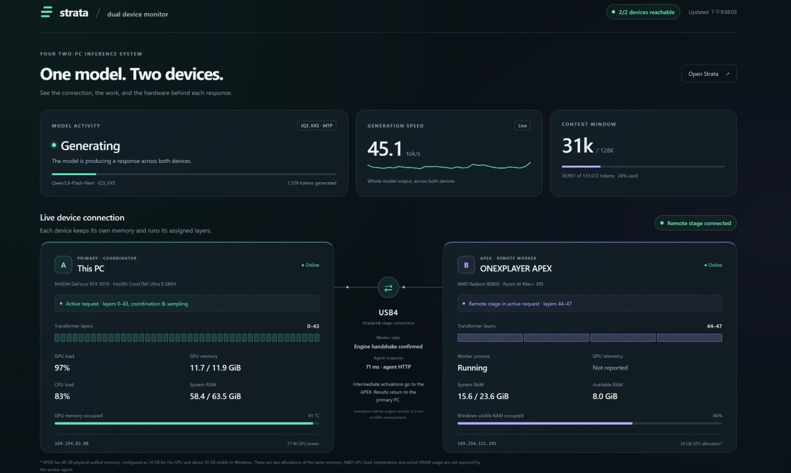
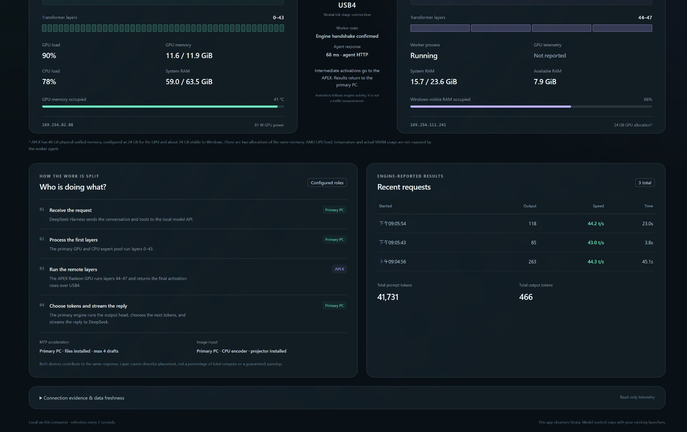
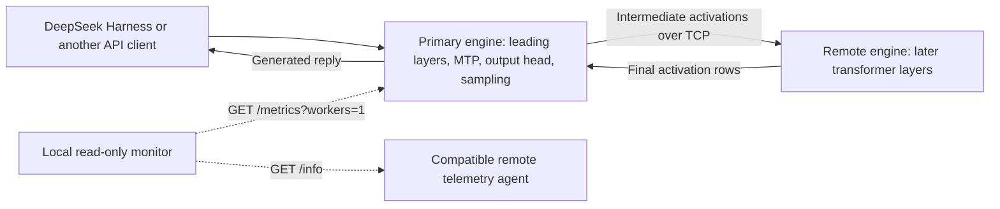

# Strata dual-device monitor

Copyright (c) 2026 **edowadolui-lab**. Original monitor program released under the [MIT license](LICENSE).

An independent community dashboard for an existing primary Strata engine and one remote transformer stage. It observes model activity, the layer split, device memory, whole-model throughput and source freshness. The collector runs locally and uses Node.js built-ins; no package installation is required.

This repository does not start or configure distributed inference. Set up the experimental [StrataLink fork](https://github.com/lask3802/Strata) first. The engine and remote-stage implementation are separate work by their respective contributors. See [Strata](https://github.com/Niko1221/Strata) and the fork's [remote-stage documentation](https://github.com/lask3802/Strata/blob/main/docs/REMOTE_STAGE.md).

Read the [Windows RTX 5070 + Radeon 8060S hardware report](docs/hardware-report.md), [configuration and replay instructions](docs/reproduce.md), and [sanitized measurements](reports/measurements.json).

## Monitor screenshots

These user-supplied screenshots show the deployed monitor on October 21, 2026. The overview reads about 31K tokens in a configured 128K window and 45.1 tokens/s. Recent requests in the second image show 43.0–44.3 tokens/s. They are live snapshots with unspecified workloads, separate from the short-prompt samples in the report. They show an earlier local deployment; this portable source uses configurable device labels.





## Architecture



The remote layer assignment is read from engine metrics. Each engine owns its own memory, expert cache and session state. Layers execute in stages; the dashboard does not imply two independent token streams or one pooled RAM/VRAM allocation. TCP can travel over a USB4 network adapter or another private network.

## Windows installation

Download the Windows x64 installer ZIP from [Releases](https://github.com/edowadolui-lab/strata-dual-device-monitor/releases), extract it, and run `Install.cmd`. The package includes its own verified Node.js runtime and installs for your Windows account without administrator access. Use **Configure Strata Dual Device Monitor** to enter your existing engine and telemetry-agent connection settings, then use the Start shortcut.

Read the [installation guide](docs/install.md) for prerequisites, configuration, upgrades and removal. This package installs the monitor. StrataLink, model files and a compatible remote telemetry agent are separate prerequisites.

## Run from source

Requirements: Node.js 22 or newer, a running StrataLink primary API, and a compatible remote telemetry agent. The dashboard was developed for Windows CUDA + HIP, but its collector itself uses portable Node APIs. Other systems have not been validated.

1. Copy `config.example.json` to `config.json`.
2. Set the primary API endpoint, remote agent endpoint and exact `stagePeer` reported by the engine. The example `192.168.50.2` address is a placeholder. CPU/GPU identity strings and transport labels are operator-supplied and must match your hardware. Keep the metrics endpoint on loopback.
3. Supply credentials in the process environment. In PowerShell:

   ```powershell
   $env:STRATA_API_KEY = 'your-existing-primary-api-key'
   $env:STRATA_STAGE_TOKEN = 'your-existing-agent-token'
   node server.mjs
   ```

4. Open <http://127.0.0.1:47832>.

Use a separate terminal or your existing launcher to supply credentials. The monitor never displays them, never reads your shell history, and never reads browser or chat state. `config.json` is ignored by Git. Do not commit secrets. As an alternative to environment variables, local config supports `primary.apiKey` and `remote.stageToken`.

Optional environment settings:

| Variable | Meaning |
|---|---|
| `STRATA_MONITOR_CONFIG` | Path to a local configuration file |
| `STRATA_MONITOR_PORT` | Dashboard port, default `47832` |
| `STRATA_METRICS_URL` | Override primary loopback metrics URL |
| `STRATA_AGENT_URL` | Override remote agent URL |
| `STRATA_REMOTE_PEER` | Exact engine worker address, such as `192.168.50.2:7841` |

Set `mtp.enabled` or `vision.enabled` only when those features are configured in the engine. Optional file paths are checked locally for existence and are not returned to the browser. These checks do not prove that the running engine loaded those files. The engine remains authoritative for its actual configuration.

Stopping this monitor leaves model processes under your existing launchers. The HTTP server binds only `127.0.0.1`; it exposes cached `GET /api/status` and `GET /api/health`, rejects other HTTP methods, and has no model control endpoint. Outbound polling uses authenticated GET requests and rejects redirects. Primary requests are restricted to loopback; remote agent URLs are restricted to private IPv4 or loopback HTTP addresses. Keep the agent's authentication and firewall protection enabled.

GitHub Pages can display source documentation, but it cannot run this local Node collector. The live dashboard must run on the primary PC.

## Telemetry contract and limits

The primary collector expects `/metrics?workers=1` to return `engine`, `live`, optional `hardware` / `hardware_static`, and `stages.workers`. The remote telemetry agent is a separate deployment component, not supplied by this monitor and not claimed to be a standard Strata API. Its authenticated `GET /info` uses the `X-Stage-Token` header and returns this minimal shape:

```json
{
  "ok": true,
  "cpus": 32,
  "ram": { "total_mib": 24576, "available_mib": 8192 },
  "workers": [7841],
  "ports": { "7841": { "running": true, "restarts": 0 } }
}
```

These are illustrative values. The remote host name and arbitrary raw agent fields are not exposed. If the agent is absent, the primary metrics still appear while remote host telemetry is marked unavailable.

- AMD utilization, temperature, power and actual GPU memory use are not provided by this contract. They appear as unavailable; configured hardware identity is not sensor evidence.
- Whole-model tokens/s comes from primary engine metrics. It is not a per-device rate.
- Agent response time includes HTTP and agent work. It is not measured network wire latency or bandwidth.
- Connector animation follows the model phase. It is not measured packet traffic.
- Timing availability is reported from engine evidence. The status JSON carries engine-supplied timing values; missing values stay null. The current UI does not graph individual stage timings.
- Failed or stale sources clear current readings. Previously observed layer ranges can remain visible as assignments; active offload is confirmed only by a current connected stage and no reported stopped worker.
- CPU-visible memory and a unified-memory GPU reservation are not summed as extra physical capacity.
- Configured context capacity does not establish successful testing at that entire prompt length.
- Prompt reuse and expert-cache hit rates are separate metrics. This monitor does not fabricate a combined cache hit percentage.

## Tests

```powershell
node --test server.test.mjs
```

Tests use synthetic responses and temporary fixture files. They do not run inference, alter engines or contact the two deployed PCs. Coverage includes authenticated read-only polling, stage matching, missing sensors, stale readings, secret redaction, configuration overrides, HTTP method restrictions and static-path containment.

## Attribution and license

The monitor source, CSS and simple SVG assets in this repository were created for this community dashboard with AI assistance. They do not contain copied Strata engine or GUI source. MIT license: see [LICENSE](LICENSE). Strata and StrataLink names identify compatible projects and do not imply endorsement. Distributed engine code, model weights and runtime binaries are not included and retain their own licenses.

The accompanying benchmark report records one experimental NVIDIA + AMD deployment. Its reported results and remaining validation limits are separate from what this telemetry UI can measure.
