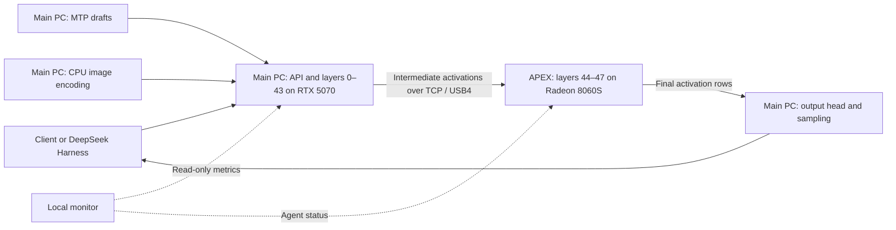

# Windows NVIDIA + AMD remote layer split with a dual-device monitor

This community test uses an NVIDIA RTX 5070 in the main PC and an AMD Radeon 8060S in an ONEXPLAYER APEX as separate Strata processes, linked over TCP on a direct USB4 network. Text, a forced tool call, a simple image fixture and short decode checks passed. The accompanying monitor displays device roles, connection state and the metrics the two processes actually expose.

The distributed engine is **[lask3802/Strata](https://github.com/lask3802/Strata), StrataLink `v0.1.45.3-link.1`**, commit [`3015d458b52e7787bc10b2c38717973b321914a9`](https://github.com/lask3802/Strata/commit/3015d458b52e7787bc10b2c38717973b321914a9). Credit for remote stages belongs to that project and its [remote-stage work](https://github.com/Niko1221/Strata/pull/1748). This report adds a local Windows CUDA/HIP hardware combination and an external monitor. It does not establish mixed-vendor support in stock Strata.

This is a **compatibility and smoke-test report**, not a complete run of the standard community benchmark. Each reported test was run once. Measurements were captured on October 21, 2026 local time (October 22 UTC). Machine-readable numeric records are in [measurements.json](../reports/measurements.json); model responses and private session data have been omitted.

## Hardware and software

| | Main PC | Worker PC |
|---|---|---|
| CPU | Intel Core Ultra 9 285H, 16 cores / 16 logical processors | AMD Ryzen AI Max+ 395 |
| GPU | NVIDIA GeForce RTX 5070, 12 GB dedicated VRAM | Radeon 8060S, HIP target `gfx1151` |
| Physical memory | 64 GB system RAM | 48 GB unified memory, configured about 24 GB for GPU and 24 GB for Windows |
| OS | Windows 11 Pro, build 26200 | Windows; build not captured |
| Driver | Windows driver `32.0.16.2101` | Driver version not captured |
| Cluster engine | StrataLink 0.1.45.3, CUDA 13.0 release build | Same source commit, local HIP build |
| HIP build | — | ROCm `10.2.0a20260930`; VS 2022 BuildTools 14.44 |

GB labels in this table are hardware capacity labels. APEX's two allocations divide its **48 GB of physical memory**; they do not create another 48 GB. The main PC's Intel integrated GPU does not perform model layers in this setup.

The worker HIP build passed device listing and selftest (both exit 0). Its executable SHA-256 is `0709eae77ecffaeef9c5365008c2179ad8bd8573b761180f81f66d5cddbb30e2`. A local build-tool selector adjustment pinned VS 2022; this report does not claim an unmodified clean-machine HIP installation was tested.

The model is [`SC117/Qwen3.8-Flash-Next-GSQ-RCO-abliterated-GGUF`](https://huggingface.co/SC117/Qwen3.8-Flash-Next-GSQ-RCO-abliterated-GGUF), **IQ3_XXS**, revision `eec4e10a2c29b440a2ae85591fa11569ce752963`. The two model shards total 76,142,283,328 bytes. Artifact names, hashes and public download URLs are recorded in the numeric report. The model repository's “abliterated” label identifies the artifact used; behavioral claims about censorship were not tested here.

`mtp-q2_0.gguf` and its prepared runtime are installed, as is `mmproj-Qwen3.8-Flash-Next-BF16.gguf`. No weights or runtime binaries are distributed in this monitor repository.

## Work distribution

- Main layers: **0–43**. Worker layers: **44–47**. The output head, MTP draft layer, sampling and API remain on the main PC.
- Each process owns the experts and attention/GDN state for its own layers. Memory remains separate on the two PCs.
- The worker uses 2,048 expert-cache slots, covering the experts for its assigned four layers. This does not make the main GPU's cache hit rate 100%.
- A verify window traverses the stages sequentially. The devices do not independently generate different tokens at the same time. `--pipeline-windows 0` is used.
- The link carries activations and protocol state over TCP. Ethernet was connected but was not aggregated with USB4. Link bandwidth and wire latency were not measured for this report.
- Image encoding uses the main PC's CPU (8 threads, image-token limit 300), followed by the same model stages. The worker has no image encoder or MTP model.

The fork's [remote-stage documentation](https://github.com/lask3802/Strata/blob/3015d458b52e7787bc10b2c38717973b321914a9/docs/REMOTE_STAGE.md) explains the architecture. Its original requirements and results concern other hardware; this report records only the combination above.

## Cohort A: same short prompts, 32K configuration

The same neutral code, explanation and prose prompts were sent to each configuration with temperature 0, thinking disabled and an output limit of 256 tokens. Each configuration had a two-token warmup. Prompt text and a generic replay procedure are in [reproduce.md](reproduce.md).

**The baseline is engine 0.1.47, while the cluster is StrataLink 0.1.45.3.** Other runtime behavior can differ between these engines. This is useful descriptive evidence, but it does not isolate the layer split as the cause of a speed difference.

| Prompt | Prompt tokens | Baseline decode tok/s | Cluster decode tok/s | Baseline wall seconds | Cluster wall seconds |
|---|---:|---:|---:|---:|---:|
| Code | 45 | 41.4 | 58.3 | 7.172 | 4.922 |
| Explanation | 49 | 40.3 | 47.5 | 7.281 | 6.422 |
| Prose | 45 | 45.1 | 52.9 | 6.672 | 5.485 |

All three returned 256 output tokens. These lengths truncate the requested longer answers; the checks establish successful output and timings, not completion or quality of those tasks. There is one measured run per cell, with no variance estimate. The cluster additionally passed an arithmetic check, one forced `record_test` tool call and a simple red-rectangle/text vision fixture. Those functional checks are not representative workloads.

## Cohort B: short requests with 128K allocated

The later cluster configuration increased `--max-context` to **131,072 tokens**, used `--kv int8`, a **32,768-token resident KV window**, and two prompt checkpoints. Older KV can reside in host RAM. Both the main and worker reported 131,072, and the remote handshake passed. **A full 128K prompt was not prefilled or recall-tested.**

| Request | Prompt total | Read / reused | Output | Decode tok/s | Primary expert-cache hit | MTP offered / accepted |
|---|---:|---:|---:|---:|---:|---:|
| Neutral code | 76 | 76 / 0 | 512 | 66.1 | 61.0% | 445 / 358 |
| Follow-up | 625 | 556 / 69 | 476 | 74.9 | 67.3% | 393 / 339 |

The first response ended at its output-length limit; the second ended normally. These requests differ from Cohort A in prompt history, output length and configuration. They are not a direct speedup comparison against its baseline, and do not establish a minimum 50 tok/s for every workload. Exact prompt text for these two requests was not retained in the numeric source record, which limits exact replay.

At those snapshots the primary cache had 2,300 slots / 3,802 MiB, with 846 MiB GPU free reported by the engine. System RAM use was about 57.2 GiB. This is tight memory headroom, not evidence that the full context can be exercised without memory pressure.

## Cohort C: two-turn prompt reuse

A separate neutral reference fixture read 2,059 prompt tokens on its first turn. Its follow-up reused **2,052** tokens and read **44** new tokens (2,096 total), giving **97.9% prompt reuse**. Wall time fell from 6.907 to 0.728 seconds. Both six-token sentinel outputs matched.

This is **prompt reuse**, not expert-cache VRAM hit rate. The primary expert-cache hit rate in these two requests was 46.8% and 43.6%. An earlier fixture attempt changed the existing prefix between turns and did not reuse it; that attempt is excluded from success measurements and does not demonstrate an engine cache defect.

## Live deployment screenshots

The following screenshots were supplied by the user for publication. The overview shows 45.1 tokens/s with about 31K tokens in the configured 128K context. The recent-request view shows 43.0, 44.2 and 44.3 tokens/s. Their workloads and run settings were not captured with these images, so these are observational UI snapshots, not another matched benchmark cohort. They demonstrate that the higher short-test rates above are not a guaranteed minimum in live use.

## What the monitor measures

The external local service reads the primary server's authenticated `/metrics?workers=1` and the worker agent's authenticated `/info`. It presents the connection, layer ranges, device responsibilities, available host/GPU metrics, request timings, MTP configuration and installed support-file checks. It does not send inference requests or control model loading. The offered/accepted MTP counters in this report are saved benchmark evidence, rather than additional live UI counters.

There are important measurement boundaries:

- Generation speed is the combined request's engine decode speed, not separate NVIDIA and AMD throughput.
- The primary expert-cache hit rate belongs to the primary process. The remote-stage protocol does not expose worker expert-hit counters for a combined percentage. **A primary hit rate above 90% was not achieved.**
- AMD GPU utilization, temperature and current VRAM use are unavailable through this agent and are shown as unavailable.
- Agent HTTP response time includes agent processing; it is not USB4 wire latency or measured bandwidth.
- Diagram animation illustrates the current execution phase. It is not measured packet traffic. Per-stage work timing was not collected for these measurements.
- This is an external monitor. A local native-UI observation bridge was also tested during setup, but it is not included or proposed as an upstream engine change here.

## Observed problems and work not done

Earlier long-session use exhausted a small output budget under the former 32K client/server configuration and repeatedly stopped at the output limit. Increasing the configured context and aligning the client budget allowed the neutral checks above; long-running agent completion is not established by these tests.

Primary engine logs contain repeated low-free-VRAM warnings, including later values below 1 GiB. The engine warned about possible WDDM paging. Successful short tests do not prove that paging cannot occur during longer or concurrent workloads. No additional inference was run merely to prepare this publication.

Not tested: full 128K prefill/recall; a context-length sweep; sustained stability/thermal performance; multiple clients; network interruption recovery; direct USB4 bandwidth/latency; a same-commit single-PC baseline; repeated benchmark variance; broad tool-use or vision accuracy; AMD sensor integration; automated clean-machine installation. Worker OS build and GPU driver version remain unknown in the saved evidence.

The purpose of publishing this report is to share a reproducible topology, honest local evidence and a usable monitor, and to help maintainers assess further mixed-backend remote-stage testing.
